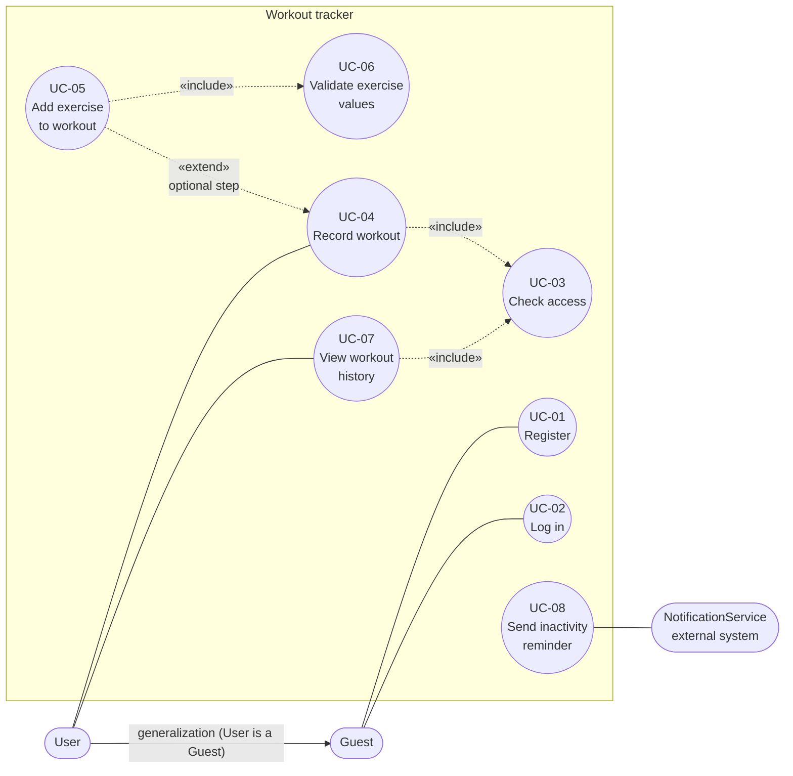

# Use case diagram

- stadium shape = actor, ellipse = use case
- solid line = association
- dashed arrow with `«include»` = base use case → included use case
- dashed arrow with `«extend»` = extending use case → base use case
- `generalization` arrow = specialization → general actor (User is a Guest)

## Use cases

| ID    | Use case                 | Actor               | Requirements |
| ----- | ------------------------ | ------------------- | ------------ |
| UC-01 | Register                 | Guest               | R-01         |
| UC-02 | Log in                   | Guest               | R-02, R-03   |
| UC-03 | Check access             | (included)          | R-04         |
| UC-04 | Record workout           | User                | R-05, R-08   |
| UC-05 | Add exercise to workout  | User                | R-06         |
| UC-06 | Validate exercise values | (included)          | R-07         |
| UC-07 | View workout history     | User                | R-10         |
| UC-08 | Send inactivity reminder | NotificationService | R-11         |

## Why these relations

- **Generalization (User → Guest):** `spec.md` defines User as a specialization of Guest. A User can do everything a Guest can.
- **`include` UC-04, UC-07 → UC-03:** recording and viewing workouts always require the access check, so it is not optional (R-04).
- **`include` UC-05 → UC-06:** every added exercise is always validated (R-07).
- **`extend` UC-05 → UC-04:** a workout can be saved with no exercises (R-08), so adding exercises is an optional step of recording a workout.
- **NotificationService** only receives a reminder request (R-11). Delivery is outside the system.
- **Not shown:** deleting an exercise (R-09) has no use case yet. It is marked as uncovered in `traceability-matrix.md`.
