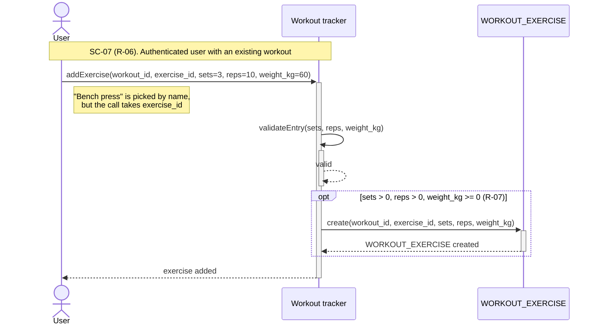
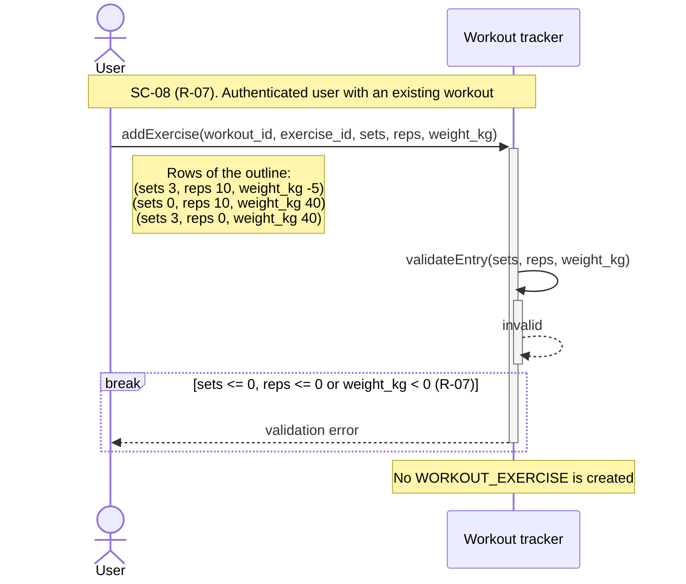
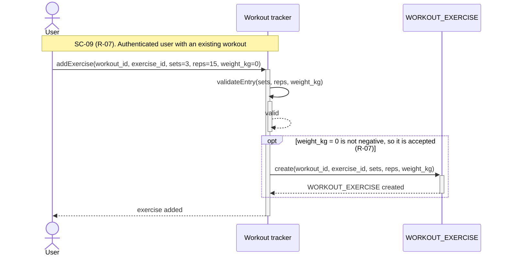

# UC-05 sequence diagrams for workout exercises

## User:

> 10/28/2026 16:55:00

> File: spec.md

> File: ears-requirements.md

> File: gherkin-scenarios.md

> File: spec_1.md

> File: traceability-matrix.md

> File: use-case.md

> File: spec_167219.md

I'm working on Task 3 (sequence diagram) of my course. I attached my files from Tasks 1 and 2 and my Task 3 spec.md. Please create three mermaid sequence diagrams for UC-05 "add exercise to workout", one for each scenario: SC-07 (add an exercise), SC-08 (invalid values) and SC-09 (zero weight). Use only participants that actually act: User, Workout tracker, and WORKOUT_EXERCISE only where a record is created. Show activation bars on the system for the whole execution, at least one alt/opt/loop/break fragment in each diagram, and a dashed return for every call. Use realistic call names, field names exactly as in task1/spec.md, and only R-xx and SC-xx ids from my files. SC-07 adds the exercise by name, but the call takes exercise_id, so show that in a note and don't invent a lookup step. Don't invent anything else.

## Assistant:

> 10/28/2026 16:55:25

> Drafting the sequence diagram for the scenario with valid values.
>
> - Drafting the sequence diagram for the scenario with valid values.
> - **Done**

Here are the three diagrams. All use only `User`, `Workout tracker` and, where a record is created, `WORKOUT_EXERCISE`.

## SC-07: Add an exercise

## SC-08: Invalid values

## SC-09: Zero weight

Choices I made:

- **Access check:** I left out an access-check call. All three Gherkin scenarios start from "Given an authenticated user", so I put that in the notes instead. An unauthenticated branch would be a different scenario (SC-04, R-04), which you didn't ask for.
- **Fragments:** SC-07 and SC-09 use `opt` around creation, so it only happens when the values pass validation. SC-08 uses `break` because the flow stops at the validation error.
- **Activation bars:** `Workout tracker` is active from `addExercise()` to its final return. `validateEntry()` is a self-call, so it nests inside that bar.
- **Ids:** Only R-06, R-07, SC-07, SC-08 and SC-09 appear, and all exist in your files.
- **Mermaid limits:** Mermaid has no way to draw an unconditional `opt`. In SC-07 and SC-09 the guard text repeats the validation result, because the diagram has to show a fragment.

Powered by Claude Exporter (https://www.ai-chat-exporter.net)
