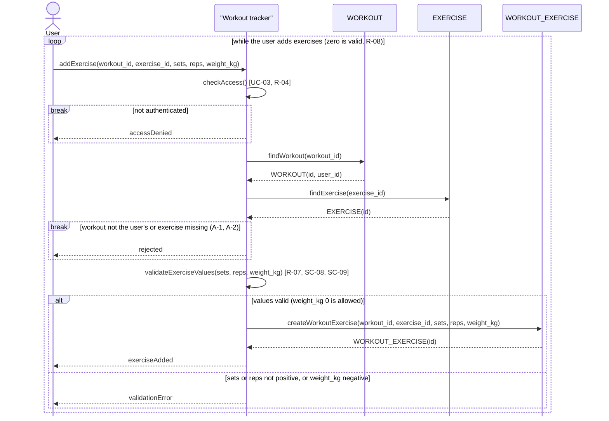

# Sequence diagram: UC-05 Add exercise to workout

## How the diagram details UC-05

UC-05 only says that a user adds an exercise to a workout. The diagram shows the order of the work: access check (UC-03, R-04), lookup of the `WORKOUT` (owned by the user, R-06) and the `EXERCISE`, included validation (UC-06, R-07) and the creation of the `WORKOUT_EXERCISE` with `workout_id` and `exercise_id` (R-06). The `break` blocks are early exits (no access, wrong workout or exercise), and the final `alt` covers SC-08 (invalid values are rejected, nothing is created) and SC-09 (`weight_kg` 0 passes). The `loop` is the optional extension of UC-04: it can run zero times (R-08, SC-06) or many times.

## Link to the data model

Every object is a task 1 entity and every message parameter is a field of `WORKOUT_EXERCISE`. `WORKOUT.user_id` is used to check ownership, and the new row gets `workout_id` and `exercise_id` as foreign keys, matching the 1:N relations in `task1/spec.md`.
